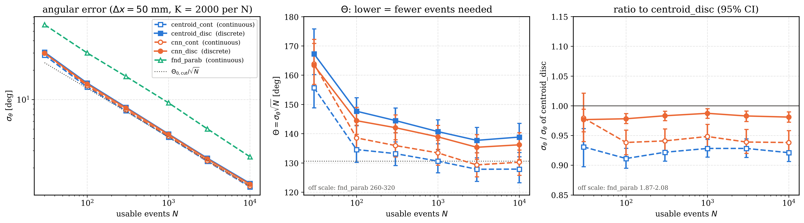
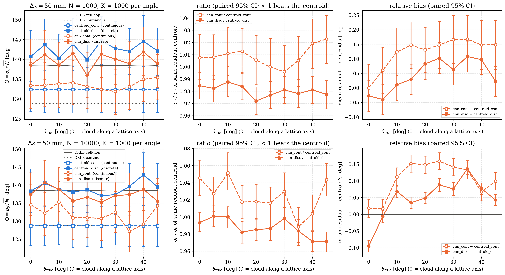
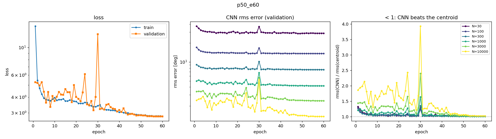
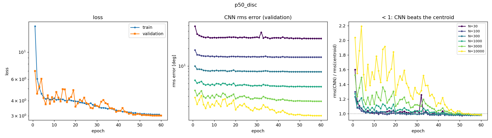

# cnn: direction reconstruction with a ResNet

This folder trains a CNN to estimate the neutrino direction θ from a bulk sample of N IBD events.
The goal is to reach a given angular resolution σ_θ with as few events as possible, which means
pushing Θ = σ_θ√N below the centroid's. The model is Zev's modified ResNet50, repurposed from
`Proton64_Reco_Model`; the original proton code is still in `~/inference_loop/Proton64_Reco_Model`.

## Results so far: 50 mm pitch

**Summary.** At 50 mm the CNN matches the centroid and reaches the Cramér–Rao bound (CRLB), but it is
not meaningfully better. With exact positions it is 1–2% worse than the continuous centroid. With
the detector's cell readout it is 1–2% better than the discrete centroid. Both CNNs are about 2×
better than FND. At this pitch the mean displacement seems to carry essentially all the direction
information. The CNN's performance and bias vary with the direction relative to the cell lattice,
although the bound does not (see [orientation](#orientation-dependence)). 5 mm has not been
trained yet (`configs/cnn_capacity.yaml`).

**Setup** (study `cnn_p50_check`, [config](../configs/cnn_p50_check.yaml), Slurm job 61354112):
- Two ResNet50 models (small stem, 60 epochs, about 26 min each on an A100):
  `cnn_cont` = checkpoint `p50_e60` (continuous displacements binned on the 50 mm grid) and
  `cnn_disc` = `p50_disc` (cell-to-cell hops, what the detector reads out).
- Evaluated by `run.py` on events `[0, 2M)`, which training never saw. K = 1000 trials at each of
  θ_true = 0° and 37°, pooled to 2000 per N.
- Every method sees the same samples, so the ratios are paired. Their 95% intervals (bootstrap) are
  much tighter than the ±1.6% error on each Θ alone.



Θ = σ_θ√N [deg] (lower = fewer events needed), and σ_CNN / σ_centroid for the centroid with the same
readout:

| N | centroid cont | CNN cont | CNN / centroid (cont) | centroid disc | CNN disc | CNN / centroid (disc) | FND |
|---|---|---|---|---|---|---|---|
| 30 | 156 | 164 | 1.052 [1.015, 1.091] | 167 | 163 | 0.977 [0.956, 0.995] | 320 |
| 100 | 135 | 139 | 1.030 [1.014, 1.045] | 148 | 145 | 0.978 [0.970, 0.987] | 301 |
| 300 | 133 | 136 | 1.021 [1.007, 1.035] | 145 | 142 | 0.983 [0.975, 0.991] | 299 |
| 1000 | 131 | 134 | 1.022 [1.008, 1.035] | 141 | 139 | 0.987 [0.980, 0.995] | 293 |
| 3000 | 128 | 129 | 1.012 [0.997, 1.026] | 138 | 135 | 0.983 [0.974, 0.991] | 275 |
| 10000 | 128 | 130 | 1.019 [1.005, 1.033] | 139 | 136 | 0.981 [0.973, 0.989] | 260 |

The CRLB at 50 mm (`results/crlb/`; the same at every orientation, see below) is 128.8 for
continuous positions and 138.5 for cell-hop readout. The centroids sit at these bounds within
errors, so neither readout has much room left. The ratios from training-time validation agree:
about 1.02 for `p50_e60` and 0.98–0.99 for `p50_disc` (`log.csv`).
FND here is `fnd_parab` with a full-circle scan.

### Orientation dependence

θ_true rotates the event cloud relative to the fixed cell lattice. Both CNNs see a histogram on that
lattice: the continuous model's input is binned too. Study `cnn_angle` ([config](../configs/cnn_angle.yaml),
2026-11-24, job 63475321) covers θ_true = 0–45° in 5° steps at N = 1000 and 10,000, with K = 1000.
Because of the lattice's symmetry, that range covers every orientation. The same K samples are
used at every angle, so differences between angles come only from the rotation. As a check, the
continuous centroid, which is exactly rotation-invariant, gives an identical Θ at every angle.



- **The bound doesn't depend on orientation.** The cell-hop CRLB is 138.4–138.5 at every angle
  (`python -m dirreco.fisher --pitches 50 --theta 0,5,...,45` → `results/crlb/crlb_angle.csv`).
  Off-axis directions hold no extra information.
- **The estimators do depend on it, by a few percent.** At N = 10k on the same samples:
  - discrete centroid: Θ = 137–143;
  - discrete CNN: 135–141, with CNN / centroid between 0.97 and 1.00. It is about 1.00 at 0–10°
    and 0.97–0.99 at most other angles, but not monotonically.
  - continuous CNN: 127–135, against a constant 128.7 for the continuous centroid. The ratio runs
    from 0.99 to 1.05 and jumps around, being worst at 0°, 10° and 45°. Since the centroid and the
    bound are both flat, this is the network itself: it is not exactly rotation-equivariant.

  All of these values lie within about ±3% of the CRLB, which is also roughly the error on each Θ.
- **Averaged over orientation**, the paired ratios are close to the two-angle numbers above. For the
  discrete CNN: 0.981 [0.972, 0.989] at N = 1000 and 0.987 [0.978, 0.997] at 10k. For the continuous
  CNN: 1.009 [0.997, 1.024] and 1.024 [1.011, 1.037].
- **Bias.** Relative to the centroid on the same samples, the CNN's bias follows the angle:
  - It is near 0 (continuous) or −0.09° (discrete) along the axis, and +0.10 to +0.16° at 15–35°.
  - It is the same size at N = 1000 and 10,000, so it doesn't average down. It is a systematic of
    about 0.1–0.15°: negligible at N = 10k (σ ≈ 1.3°), but comparable to σ at N ≳ 10⁶ (σ ≈ 0.13°).
  - Training on uniformly random θ does not remove it. If the CNN is used at high statistics,
    either correct it or train with input rotation averaging (test-time augmentation).

The first two-angle look (θ = 0° vs 37°) is `plot.py cnn_p50_check --figure angle`.

### Training




Validation rms error relative to the centroid, per N. Both runs converge only once the
learning-rate schedule anneals (epochs 45–60). The large-N ratios are noisy before then, and the
continuous run has a one-epoch spike at epoch 30. A 20-epoch continuous run (`p50_e20`) ended at
ratio 1.03; 60 epochs reached 1.02.

## What the network sees and predicts

- **Input.** One image is the 2D histogram of the displacements r = capture − vertex of the N events
  (cells of one pitch, centred on r = 0, ±200 mm; 9×9 at 50 mm, 81×81 at 5 mm). Pixels hold
  counts·S²/N. `--representation discrete` histograms the cell-to-cell displacement instead, which is
  what the detector reads out. See `images.py`.
- **Output.** A 2-vector u. The estimate is θ̂ = atan2(u_y, u_x), so there is no wrap-around problem.
- **Loss.** N·(1 − cos(θ̂ − θ)) ≈ N·err²/2, the mean Θ² over the batch, so every N counts equally.
  `--weighting none` drops the N factor, which makes the smallest N dominate.
- **Training data.** Samples are generated on the GPU on the fly. Each image draws N log-uniform in
  [30, 10000] usable events and rotates them by θ ~ U(−180°, 180°). Each epoch is new data.
- **No reference sample.** Like the centroid, the CNN needs none. FND/EMD build their θ = 0
  template from N reference events; the CNN learns it from the training pool. Keep this in mind
  when comparing it to the template methods.

## Data split

| Event indices | Use |
|---|---|
| `[0, 2,000,000)` | Never trained on. Reserved for `run.py` studies: set `data: {max_events: 2000000}` |
| `[2,000,000, 2,500,000)` | Validation (fixed set, same seed every epoch) |
| `[2,500,000, end)` | Training |

## Usage (from the repo root)

```bash
sbatch cnn/submit_train.sh --pitch 50                           # one model per pitch (~30 min)
sbatch -t 0-08:00 cnn/submit_train.sh --pitch 5                 # 81x81 images: ~5 h, ~60 GB GPU
sbatch cnn/submit_train.sh --resume cnn/checkpoints/resnet50_p50_continuous/last.pt

python cnn/plot_loss.py cnn/checkpoints/resnet50_p50_continuous # -> training.png
python run.py configs/cnn_capacity.yaml --jobs 1                # CNN vs centroid / FND
```

Run `python -m cnn.train -h` for all options:

- `--representation`;
- `--arch` (resnet18/34/50/101/152);
- `--stem` (`small` for small images, `imagenet` for the original 7×7/2 + max-pool);
- `--n-min/--n-max`;
- `--theta-range`;
- `--epochs/--steps-per-epoch/--batch-size/--lr`.

Each checkpoint stores its args and image spec, so the `cnn` method in `dirreco/methods/cnn.py` can
rebuild the identical input. Outputs go to `cnn/checkpoints/<arch>_p<pitch>_<representation>/`:
`best.pt` (lowest validation loss), `last.pt`, `log.csv` and `args.json`.

`log.csv` and the per-epoch printout give, for each validation N, the CNN rms error and its ratio to
the centroid computed on the same samples. A ratio < 1 means the CNN beats the centroid.

## Files

| File | What |
|---|---|
| `images.py` | Event sample → image. Shared by training and evaluation |
| `resnet.py` | ResNet18–152; 1 input channel, 2 outputs, `stem` option |
| `train.py` | Training loop, validation, checkpoints |
| `submit_train.sh` | SLURM wrapper (iaifi_gpu; 1 h, 2 cores, 6 GB by default). Its header has the measured costs per pitch. Forwards SIGTERM so the last epoch is saved |
| `submit_multi.sh` | Packs several small-pitch runs onto one GPU. Run it directly, not with sbatch: `cnn/submit_multi.sh "--pitch 50" "--pitch 150"`. It sizes the request and submits itself |
| `benchmark.py` | Measures s/step, GPU and host memory, and CPU use per config, for sizing jobs (`python -m cnn.benchmark` on a GPU node) |
| `plot_loss.py` | Loss and rms/centroid ratio vs epoch |
| `compare.py` | Prints Θ per method and its ratio to a reference, per pitch and θ_true, from a study's `summary.csv` |
